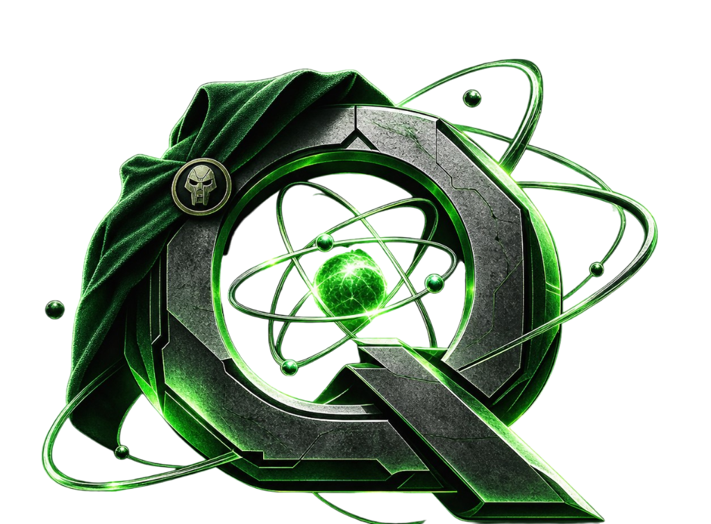
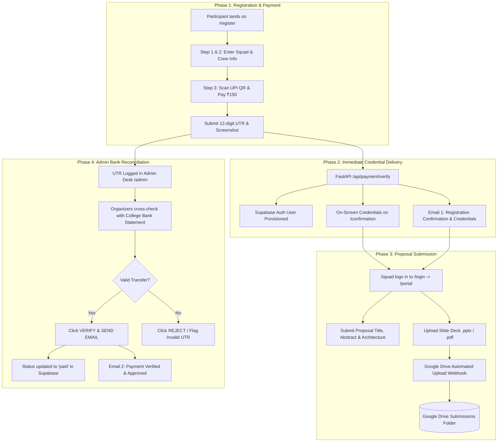

# QYRON’27 — National Quantum Computing & Mathematical Innovation Hackathon

<div align="center">



**Department of Mathematics & Patrician Institution's Innovation Council (PIIC)**  
**Patrician College of Arts and Science**, Canal Bank Road, Gandhi Nagar, Adyar, Chennai – 600 020  
*(Affiliated to the University of Madras · Re-Accredited 'A+' Grade by NAAC)*

[](https://www.python.org/)
[](https://fastapi.tiangolo.com/)
[](https://supabase.com/)
[](https://developers.google.com/drive)
[](#upi-qr-payment-workflow)
[](https://vercel.com/)

</div>

---

## 📌 Overview

**QYRON’27** is an end-to-end, full-stack event and submission platform built for the **24-Hour National Quantum Computing & Mathematical Innovation Hackathon**. The platform integrates a terminal/cyberpunk aesthetic with academic rigor, powering:

1. **Self-Service Team Registration Wizard**: 3-step registration capturing Team Details, Leader Contact, and Member Roster (2–4 members).
2. **Institutional Direct UPI QR Payment**: Seamless payment collection (₹150 entry fee) via dynamic QR scanner, UPI deep-linking, 12-digit UTR logging, and receipt screenshot attachment.
3. **Immediate Portal Credential Provisioning**: Team leader accounts are activated immediately in Supabase Auth upon registration, displaying credentials on-screen and dispatching them via automated email so teams can begin proposal submission without waiting.
4. **Automated Google Drive Proposal Storage**: Presentation slide decks (`.pptx`, `.ppt`, `.pdf`) and payment receipts are uploaded automatically to a designated Google Drive folder via a Google Apps Script Webhook.
5. **Participant Portal**: Secure portal for teams to submit proposal titles, abstracts, technical architecture methodologies, and slide decks.
6. **Organizers Admin Verification Desk**: Dedicated review dashboard to cross-reference submitted 12-digit UTR numbers against college bank records, with one-click payment verification that triggers official confirmation emails.
7. **Two-Phase Transactional Email Workflow**: Built on Gmail SMTP with Patrician College letterhead templates (free of extraneous banners).

---

## 🏗️ Architecture & Workflow



---

## 📂 Project Directory Structure

```text
QYRON 27/
├── api/                             # Vercel serverless deployment entry point
│   └── index.py                     # ASGI application handler for Vercel
├── assets/                          # Static brand imagery, logos, templates & headshots
│   ├── department-ramanujan-logo.png # Department of Mathematics Ramanujan Association emblem
│   ├── department-phoenix-logo.png  # Department crest alias
│   ├── patrician-college-logo.jpg   # Patrician College official crest
│   ├── qyron-logo-doomsday.png      # QYRON'27 event brand mark
│   ├── qyron-proposal-outline.pptx  # Standardized 7-slide proposal template
│   ├── upi-qr-scanner.jpg           # Institutional UPI QR code scanner image
│   └── ...                          # Team & organizer portraits
├── backend/                         # FastAPI application backend
│   ├── routers/                     # HTTP route controllers
│   │   ├── admin.py                 # Admin dashboard endpoints & scoring
│   │   ├── auth_routes.py           # Supabase Auth session & token routes
│   │   ├── participant.py           # Participant profile & roster endpoints
│   │   ├── registration_wizard.py   # Squad registration, UPI verify & proposal submission
│   │   └── __init__.py
│   ├── services/                    # Cloud integration services
│   │   ├── gdrive.py                # Automated Google Drive upload service (Webhook & Service Account)
│   │   └── __init__.py
│   ├── auth.py                      # Security dependencies & Supabase JWT validation
│   ├── config.py                    # Environment settings loader (Pydantic / dotenv)
│   ├── db.py                        # Supabase client factory (Anon & Service Role)
│   ├── mailer.py                    # Dual-phase SMTP email dispatch (Patrician letterhead)
│   ├── main.py                      # Application bootstrap, CORS, and static route mounting
│   └── models.py                    # Pydantic data schemas & validation models
├── css/                             # Modular stylesheets
│   ├── animations.css               # Terminal & scanline animations
│   ├── base.css                     # Base typography and reset rules
│   ├── components.css               # Buttons, badges, and input elements
│   ├── doom-theme.css               # Cyberpunk color palette & HUD variables
│   ├── feature-components.css       # Cards, grid layouts, and modals
│   ├── portal-features.css          # Portal tabs, file upload dropzones
│   ├── portal.css                   # Unified portal stylesheet
│   ├── register.css                 # 3-step registration wizard styles
│   ├── site-sections.css            # Section layouts for landing page
│   └── variables.css                # Color tokens & typography definitions
├── data/                            # Persistent local storage
│   └── registrations.json           # JSON fallback registry for team records
├── frontend/                        # Combined frontend web interfaces
│   ├── admin.html                   # Organizers administrative dashboard & UPI desk
│   ├── confirmation.html            # Post-registration confirmation & credential display
│   ├── index.html                   # Event showcase & primary landing page
│   ├── login.html                   # Participant portal authentication portal
│   ├── participant.html             # Participant dashboard view
│   ├── portal.html                  # Unified portal shell
│   └── register.html                # 3-step squad registration & UPI payment page
├── js/                              # Modular frontend scripts
│   ├── doom-cursor.js               # Interactive canvas cursor effects
│   ├── doom-eggs.js                 # Terminal Easter eggs and shortcuts
│   ├── main.js                      # Landing page navigation & modal triggers
│   ├── portal.js                    # Participant & Admin portal client logic
│   └── register.js                  # Registration wizard, UPI deep-linking & UTR handler
├── supabase/                        # Database schema & migrations
│   └── schema.sql                   # PostgreSQL schema, RLS policies, tables & triggers
├── tools/                           # Verification, diagnostics & test suites
│   ├── google_apps_script.js        # Google Apps Script webhook code for Drive uploads
│   ├── test_gdrive_upload.py        # Automated test for Google Drive integration
│   ├── test_smtp.py                 # Diagnostic tool for Gmail SMTP authentication
│   └── test_upi_flow.py             # End-to-end integration test (Register -> UPI -> Admin -> Proposal)
├── uploads/                         # Local upload storage
│   ├── payments/                    # Uploaded payment receipts (.gitkeep tracked)
│   └── ppt/                         # Fallback local proposal files (.gitkeep tracked)
├── .env                             # Local environment variables (DO NOT COMMIT)
├── .env.example                     # Environment template with documentation
├── .gitignore                       # Git ignore definitions
├── .vercelignore                    # Vercel deployment exclusions
├── favicon.ico                      # Web browser icon
├── google_apps_script.js            # Root copy of Apps Script webhook code
├── main.js                          # Root frontend script reference
├── portal.css                       # Root unified stylesheet reference
├── README.md                        # Master project documentation
├── requirements.txt                 # Python package dependencies
└── vercel.json                      # Vercel serverless deployment specification
```

---

## 🚀 Quickstart & Local Setup

### 1. Prerequisites
- **Python 3.11** or later
- **Pip** package manager
- **Git**
- A **Supabase** account (Free tier supported)
- A **Google** account (for Google Drive storage and/or Gmail SMTP)

### 2. Clone and Setup Environment
```powershell
# Clone the repository
git clone https://github.com/your-username/qyron27.git
cd "QYRON 27"

# Create a Python virtual environment
python -m venv venv

# Activate the virtual environment
# Windows (PowerShell):
.\venv\Scripts\Activate.ps1
# macOS / Linux:
source venv/bin/activate

# Install required dependencies
pip install -r requirements.txt
```

### 3. Configure Environment Variables
Copy the example configuration to `.env`:
```powershell
cp .env.example .env
```
Open `.env` and fill in your settings:
```ini
# Supabase Configuration
SUPABASE_URL=https://your-project.supabase.co
SUPABASE_PUBLISHABLE_KEY=your-supabase-anon-key
SUPABASE_SECRET_KEY=your-supabase-service-role-key
SUPABASE_EMAIL_REDIRECT_URL=http://127.0.0.1:8000/login
COOKIE_SECURE=false
ALLOWED_ORIGINS=http://127.0.0.1:8000,http://localhost:8000

# Gmail SMTP Configuration (for sending emails)
SMTP_EMAIL=your-email@gmail.com
SMTP_APP_PASSWORD=your-16-char-app-password
SMTP_HOST=smtp.gmail.com
SMTP_PORT=587
SMTP_USE_TLS=true
SMTP_FROM_NAME=QYRON'27 Organizers

# Google Drive Direct Upload Configuration
GOOGLE_DRIVE_FOLDER_ID=your_google_drive_folder_id
GOOGLE_DRIVE_WEBHOOK_URL=https://script.google.com/macros/s/your_script_id/exec

# UPI QR Payment Settings
UPI_ID=karanvasi80@okhdfcbank
UPI_PAYEE_NAME=Vasikaran A
UPI_AMOUNT=150
UPI_QR_IMAGE=/assets/upi-qr-scanner.jpg
```

### 4. Setup Database Schema
1. Open your [Supabase Dashboard](https://supabase.com/dashboard).
2. Navigate to **SQL Editor**.
3. Copy the contents of `supabase/schema.sql` and execute the query.
4. This creates all necessary tables (`registrations`, `proposals`, `profiles`, `payments`), indexes, and Row Level Security (RLS) policies.

### 5. Launch the Application
Run the local FastAPI server using Uvicorn:
```powershell
uvicorn backend.main:app --reload
```
Open `http://127.0.0.1:8000` in your web browser.

---

## 🌐 Application Route Index

| Route | File | Description |
| :--- | :--- | :--- |
| `/` | `index.html` | Event showcase, schedule, challenge tracks, prizes & judging rubric |
| `/register` | `register.html` | 3-step squad registration wizard & UPI QR payment gateway |
| `/confirmation` | `confirmation.html` | Post-registration confirmation with immediate credentials display |
| `/login` | `login.html` | Participant portal sign-in page |
| `/portal` | `portal.html` | Main participant portal for proposal submission & status tracking |
| `/admin` | `admin.html` | Organizers portal & UPI Payment Verification Desk |
| `/download/idea-template` | API | Serves the official 7-slide `.pptx` proposal outline |
| `/api/health` | API | Service health check |
| `/api/event` | API | Event metadata, track information, milestones & deadlines |

---

## 💳 UPI QR Code Payment Flow

To accommodate collegiate institutions where commercial third-party payment gateways (e.g. Razorpay) are restricted:
1. **QR Display**: The user is presented with the college's verified UPI QR code, beneficiary name, and UPI ID (`karanvasi80@okhdfcbank`).
2. **Deep Linking**: On mobile devices, clicking **"PAY VIA UPI APP"** triggers the native Android/iOS intent (`upi://pay?pa=...&pn=...&am=150&cu=INR`).
3. **UTR Verification**: The squad lead enters their 12-digit UPI Transaction Reference (UTR) number and optionally uploads a screenshot of the payment receipt.
4. **Immediate Provisioning**: The squad lead account is provisioned immediately with portal credentials so the team can proceed with proposal drafting without friction.
5. **Admin Reconciliation**: Organizers cross-reference the submitted UTR in `/admin` against college bank statements and click `[VERIFY & SEND EMAIL ✓]` to mark the payment verified and dispatch Email 2.

---

## ☁️ Google Drive Direct Upload Integration

All presentation slide decks (`.pptx`, `.ppt`, `.pdf`) and payment receipts are uploaded directly to the organizing committee's Google Drive folder without requiring complex Google Cloud IAM permissions:

### 2-Minute Google Apps Script Setup
1. Visit [script.google.com](https://script.google.com/) and create a **New project**.
2. Replace all code in `Code.gs` with the contents of [`google_apps_script.js`](tools/google_apps_script.js).
3. Click **Deploy** (top-right) -> **New deployment**.
4. Click the gear icon next to "Select type" and choose **Web app**.
5. Configure deployment settings:
   - **Description**: `QYRON 27 Submissions Webhook`
   - **Execute as**: `Me` (your Google Account)
   - **Who has access**: `Anyone` *(Crucial: must be set to Anyone)*
6. Click **Deploy**, authorize access, and copy the generated **Web app URL** (`https://script.google.com/macros/s/.../exec`).
7. Paste this URL into `.env`:
   ```ini
   GOOGLE_DRIVE_WEBHOOK_URL=https://script.google.com/macros/s/your_app_script_id/exec
   GOOGLE_DRIVE_FOLDER_ID=your_target_google_drive_folder_id
   ```
8. Verify integration by running:
   ```powershell
   python tools/test_gdrive_upload.py
   ```

---

## 📧 Dual-Phase Transactional Email System

Built on direct SMTP with Patrician College letterhead formatting:

### Email 1: Registration Confirmation & Portal Credentials
- **Trigger**: Dispatched immediately upon completing the 3-step registration wizard.
- **Contents**: Squad Callsign, Team ID, Operational Track, Submitted 12-digit UTR, active **Portal Username & Password**, login button, and proposal submission guide.
- **Purpose**: Gives teams immediate access to the portal so they can begin drafting their idea title, abstract, architecture, and slide deck.

### Email 2: Payment Verified & Registration Approved
- **Trigger**: Dispatched when an organizer clicks `[VERIFY & SEND EMAIL ✓]` in the Admin Panel.
- **Contents**: Official confirmation of verified payment (₹150), reconciled against college accounts, with a reminder of the proposal deadline.

### Testing SMTP Outbound
Verify your Gmail App Password configuration with the included diagnostic tool:
```powershell
# Test authentication
python tools/test_smtp.py

# Send a real test email to an inbox
python tools/test_smtp.py --to your-email@example.com
```

---

## 🧪 Integration Testing Suite

The repository includes end-to-end integration tests in the `tools/` directory:

```powershell
# 1. Run Complete End-to-End Registration & Verification Flow:
python tools/test_upi_flow.py

# Expected Output:
# [OK] Step 1: Registered squad with UPI QR mode
# [OK] Step 2: Credentials generated immediately. UPI UTR logged. Status is 'pending_verification'
# [OK] Step 3: Registration record verified in registry
# [OK] Step 4: Admin verified payment! Email 2 dispatched
# [OK] Step 5: Registration record confirmed active & 'paid'
# [OK] Step 6: Proposal dossier & PPT submitted successfully
# ALL TWO-PHASE PAYMENT & EMAIL VERIFICATION TESTS PASSED SUCCESSFULLY!

# 2. Test Google Drive Automated Webhook:
python tools/test_gdrive_upload.py

# 3. Test SMTP Configuration:
python tools/test_smtp.py
```

---

## 🚢 Deploying to Vercel

The platform is pre-configured for one-click serverless deployment on Vercel via `@vercel/python`:

1. **Push to GitHub**:
   ```bash
   git add .
   git commit -m "Deploy QYRON 27 platform"
   git push origin main
   ```
2. **Import into Vercel**:
   - Navigate to [vercel.com/new](https://vercel.com/new).
   - Select your repository.
   - Vercel will automatically detect `vercel.json` and map all routes to `api/index.py`.
3. **Set Environment Variables**:
   In **Project Settings → Environment Variables**, add:
   - `SUPABASE_URL`
   - `SUPABASE_PUBLISHABLE_KEY`
   - `SUPABASE_SECRET_KEY`
   - `SUPABASE_EMAIL_REDIRECT_URL` = `https://your-app.vercel.app/login`
   - `COOKIE_SECURE` = `true`
   - `SMTP_EMAIL` & `SMTP_APP_PASSWORD`
   - `GOOGLE_DRIVE_WEBHOOK_URL` & `GOOGLE_DRIVE_FOLDER_ID`
   - `UPI_ID`, `UPI_PAYEE_NAME`, `UPI_AMOUNT`, `UPI_QR_IMAGE`
4. **Deploy**:
   Click **Deploy**. Your custom domain will serve both the static cyberpunk frontend and the FastAPI backend seamlessly.

---

## ⚖️ Official Judging Criteria & Evaluation Rubric

All proposals and hackathon submissions are evaluated across 6 core criteria totaling **100%**:

| Criterion | Weight | Focus Areas |
| :--- | :---: | :--- |
| **Problem understanding and relevance** | **15%** | Clarity of problem definition, relevance to quantum & mathematics, and justification of scope |
| **Quantum computing implementation** | **25%** | Mathematical modeling, circuit architecture, gate synthesis, Hamiltonian formulations, and algorithmic rigor |
| **Innovation and originality** | **20%** | Novelty of approach, creative problem solving, and uniqueness of the quantum/mathematical solution |
| **Technical execution and working prototype** | **20%** | Simulation feasibility, Qiskit/Pennylane/SymPy execution, code cleanliness, and prototype viability |
| **Practical impact and scalability** | **10%** | Real-world utility, scalability of the model, and future application potential |
| **Presentation and demonstration** | **10%** | Slide presentation clarity, Q&A defense, and ability to communicate technical concepts |
| **Total** | **100%** | **Comprehensive Jury Evaluation** |

---

## 📅 Hackathon Key Dates & Milestones

- **Registration Deadline**: 20 January 2027 · 11:59 PM IST
- **Proposal Submission Deadline**: 25 January 2027 · 11:59 PM IST *(in Participant Portal)*
- **Announcement of Top 20 Shortlisted Finalists**: 28 January 2027
- **Finalist Round Confirmation**: 07 February 2027 *(₹350 per member for shortlisted teams)*
- **Grand 24-Hour On-Campus Hackathon**: 12–13 February 2027
- **Venue**: Patrician College of Arts and Science, Adyar, Chennai – 600 020

---

## 🏛️ Organizing Committee

**Patrician College of Arts and Science**  
*Department of Mathematics & Patrician Institution's Innovation Council (PIIC)*  
Canal Bank Road, Gandhi Nagar, Adyar, Chennai – 600 020, Tamil Nadu, India  

*“Quantum Coherence. Mathematical Precision.”*
